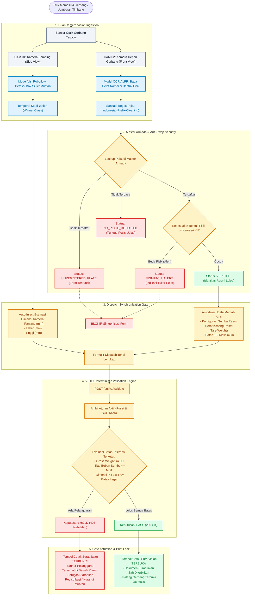
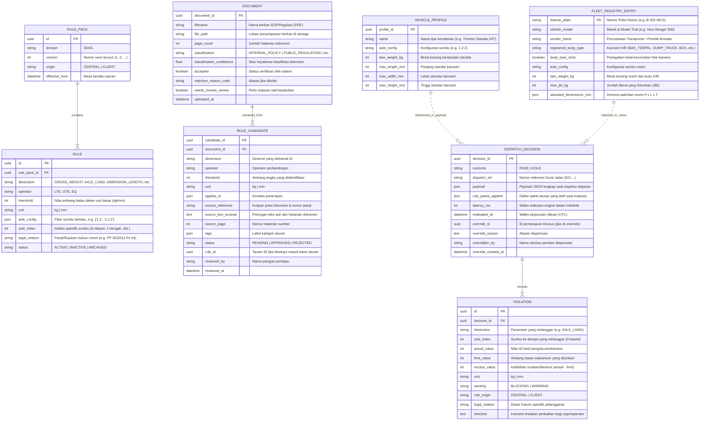

# VETO · System Architecture, Workflow, ERD & Vision Specification

> **Dokumen Spesifikasi Teknis Sistem VETO (Vehicle Enforcement & Triage Officer)**  
> Versi: `2.0-VISION` · Tanggal: Oktober 2026 · Standar Regulasi: PP 55/2012 & UU 22/2009

---

## 1. Executive Summary & Visi Sistem

**VETO (Vehicle Enforcement & Triage Officer)** adalah middleware cerdas (*intelligent compliance gateway*) yang mengintervensi alur penerbitan Surat Jalan logistik di gerbang fasilitas pergudangan (Warehouse / Distribution Center). 

Sistem ini mentransformasi proses pemeriksaan manual ODOL (*Over Dimension & Over Loading*) yang lambat dan rentan korupsi/kelalaian manusia menjadi sistem **Zero-Touch Dispatch Verification**. Dengan menggabungkan:
1. **Dual-Camera Computer Vision**:
   - **CAM 01 (Side Profiler)**: Deteksi siluet muatan & kalkulasi dimensi otomatis (Panjang $\times$ Lebar $\times$ Tinggi) via model visi komputer terlatih.
   - **CAM 02 (Gate ALPR & Cabin Scanner)**: Pengenalan pelat nomor otomatis (*Automatic License Plate Recognition*) + klasifikasi fisik bentuk karoseri truk.
2. **Master Armada & Anti-Fraud Verification**:
   - Pencocokan pelat nomor secara *real-time* ke basis data armada resmi perusahaan.
   - Deteksi indikasi tukar pelat (*license plate swapping*) jika bentuk fisik visual di kamera tidak sesuai dengan karoseri yang terdaftar di buku uji KIR.
3. **Deterministic Validation Rules Engine**:
   - Evaluasi matematis deterministik tanpa asumsi (*pure function*, $<15\text{ ms}$) terhadap regulasi pemerintah pusat (PP 55/2012, UU 22/2009) dan SOP internal klien.
   - **Hard Gatekeeper**: Surat Jalan terkunci secara digital dan hanya dapat dicetak (*print*) jika status evaluasi menghasilkan `PASS`.

---

## 2. Alur Sistem Zero-Touch (System Flowchart)

Diagram alir berikut mengilustrasikan perjalanan kendaraan sejak memasuki area jembatan timbang/gerbang hingga keputusan Surat Jalan diterbitkan atau ditahan:



---

## 3. Sequence Diagram (Komunikasi Antar Komponen)

Diagram berikut merinci komunikasi asinkron antara antarmuka web, backend proxy VETO, AI inference engine, dan basis data:

```mermaid
sequenceDiagram
    autonumber
    actor Officer as Petugas Dispatch / Operator Gerbang
    participant UI as Frontend (React Dispatch Console)
    participant API as VETO Backend API (Django)
    participant Roboflow as Roboflow Inference API
    participant OpenAI as OpenAI Vision API (ALPR)
    participant DB as SQLite / PostgreSQL Database
    participant Hardware as Gerbang / Printer Surat Jalan

    Note over Officer,UI: Truk melintasi kamera gerbang
    Officer->>UI: Unggah Foto/Video Gerbang (CAM 01 & CAM 02)
    
    par Pemrosesan Visual CAM 01 (Dimensi)
        UI->>API: POST /api/v1/vision/detect (Base64 JPEG)
        API->>Roboflow: HTTP POST Upstream (Model v8 / v6)
        Roboflow-->>API: Bounding Boxes, Confidence, Predictions
        API-->>UI: Predictions Payload + Latency
        UI->>UI: Hitung Estimasi Dimensi (P, L, T mm)
    and Pemrosesan Visual CAM 02 (ALPR & Identitas)
        UI->>API: POST /api/v1/vision/alpr (Base64 JPEG 1024px)
        API->>API: Check Daily Cap & SHA-256 Frame Cache
        API->>OpenAI: Chat Completion (gpt-4o-mini, detail: auto)
        OpenAI-->>API: JSON { license_plate, detected_body_type }
        API->>API: Sanitize Regex & Match FLEET_REGISTRY
        API-->>UI: { alpr, fleet_match: { identity_status: "VERIFIED" } }
    end

    alt Status CAM 02 != VERIFIED
        UI->>UI: Kunci input form; tampilkan peringatan fraud / pelat tak terdaftar
    else Status CAM 02 == VERIFIED
        UI->>UI: Auto-Sync: Isi Konfigurasi Sumbu, Tare, Dimensi, & Beban
        UI->>Officer: Form siap divalidasi (Tombol Kirim aktif)
    end

    Officer->>UI: Klik "Periksa Muatan" (Submit Dispatch)
    UI->>API: POST /api/v1/validate { dispatch_ref, vehicle, load }
    API->>DB: Query Aturan Aktif (RulePack & Rules)
    DB-->>API: Active Regulations (PP 55/2012 + Client Rules)
    API->>API: Pure Engine: Hitung Deviasi Beban Sumbu & Dimensi
    API->>DB: Insert DispatchDecision & Violations (Audit Trail)
    
    alt Hasil Validasi: HOLD (Ada Pelanggaran)
        API-->>UI: 403 Forbidden { outcome: "HOLD", violations: [...] }
        UI->>UI: Kunci Cetak Surat Jalan; Munculkan Modal Pelanggaran
        UI->>Officer: Panduan koreksi (misal geser muatan ke sumbu belakang)
    else Hasil Validasi: PASS (Sesuai Regulasi)
        API-->>UI: 200 OK { outcome: "PASS", decision_id: "..." }
        UI->>UI: Aktifkan Tombol "Cetak Surat Jalan"
        Officer->>UI: Klik "Cetak Surat Jalan"
        UI->>Hardware: Buka Palang & Cetak Dokumen Legal Sah
    end
```

---

## 4. Entity-Relationship Diagram (ERD)

Struktur basis data VETO dirancang untuk menjamin *auditability*, integritas regulasi versi-ke-versi, dan pencatatan komprehensif seluruh data inspeksi kendaraan:



---

## 5. Spesifikasi API & Kontrak Data (API Contract)

Semua komunikasi data terikat kontrak ketat (`/api/v1`) dengan prinsip:
- **Satuan**: Berat selalu bilangan bulat dalam kilogram (`kg`), dimensi selalu milimeter (`mm`), waktu selalu milidetik (`ms`).
- **Keamanan Kredensial**: Tidak ada kunci API Vision/OpenAI yang pernah dikirimkan ke peramban klien.

### A. Deteksi Visual Dimensi — `POST /api/v1/vision/detect`
Digunakan oleh **CAM 01** untuk memindai siluet kontur muatan dan mendeteksi potensi *overload* dimensi samping. Jika slot CAM 02 masih kosong, endpoint ini juga secara cerdas mengekstrak pelat nomor secara otomatis (`include_alpr: true`).

**Payload Permintaan:**
```json
{
  "image_base64": "/9j/4AAQSkZJRgABAQAAAQABAAD/...",
  "include_alpr": true
}
```

**Respon Sukses (`200 OK`):**
```json
{
  "predictions": [
    {
      "x": 320.5,
      "y": 240.0,
      "width": 420.0,
      "height": 280.0,
      "confidence": 0.884,
      "class": "overload",
      "class_id": 1
    }
  ],
  "alpr": {
    "plate_detected": true,
    "license_plate": "B 505 WLG",
    "plate_confidence": 0.95,
    "detected_body_type": "BAK_TERPAL",
    "visual_notes": "Truk karoseri BAK_TERPAL",
    "source": "OPENAI_VISION_OCR"
  },
  "fleet_match": {
    "license_plate": "B 505 WLG",
    "vehicle_model": "Hino Ranger 500 FL 260 JW",
    "vendor_name": "PT Veto Logistik Prima",
    "registered_body_type": "BAK_TERPAL",
    "axle_config": "1.2.2",
    "tare_weight_kg": 8900,
    "max_jbi_kg": 24000,
    "identity_status": "VERIFIED",
    "identity_verified": true,
    "body_type_match": true,
    "fraud_warning": null
  }
}
```

---

### B. Pembacaan Pelat ALPR Gerbang — `POST /api/v1/vision/alpr`
Endpoint khusus untuk **CAM 02 (Kamera Depan Gerbang)** dengan resolusi tangkapan tinggi (`1024px`, JPEG `0.88`) untuk memastikan nomor pelat terbaca tajam dan langsung dicocokkan ke basis data Master Armada.

**Respon Sukses (`200 OK`):**
```json
{
  "alpr": {
    "plate_detected": true,
    "license_plate": "B 9482 UEX",
    "plate_confidence": 0.98,
    "detected_body_type": "BAK_TERPAL",
    "visual_notes": "Truk karoseri BAK_TERPAL",
    "source": "OPENAI_VISION_OCR"
  },
  "fleet_match": {
    "license_plate": "B 9482 UEX",
    "vehicle_model": "Hino Ranger FM 260 JD",
    "vendor_name": "PT Nusantara Logistik",
    "registered_body_type": "BAK_TERPAL",
    "axle_config": "1.2.2",
    "tare_weight_kg": 9200,
    "max_jbi_kg": 24000,
    "identity_status": "VERIFIED",
    "identity_verified": true,
    "body_type_match": true,
    "fraud_warning": null
  }
}
```

**Respon Fraud Alert (Tukar Pelat — `MISMATCH_ALERT`):**
```json
{
  "alpr": {
    "plate_detected": true,
    "license_plate": "D 8831 XH",
    "detected_body_type": "DUMP_TRUCK"
  },
  "fleet_match": {
    "license_plate": "D 8831 XH",
    "registered_body_type": "BOX_TERTUTUP",
    "detected_body_type": "DUMP_TRUCK",
    "identity_status": "MISMATCH_ALERT",
    "identity_verified": false,
    "body_type_match": false,
    "fraud_warning": "PERINGATAN: Pelat D 8831 XH terdaftar sebagai BOX_TERTUTUP, namun kamera mendeteksi fisik DUMP_TRUCK (Indikasi Tukar Pelat / Tukar Surat Jalan)!"
  }
}
```

---

### C. Mesin Validasi Surat Jalan — `POST /api/v1/validate`
Endpoint sentral yang menentukan apakah Surat Jalan boleh dicetak atau ditahan (*HOLD*).

**Payload Permintaan:**
```json
{
  "dispatch_ref": "DO-2026-10-30-0001",
  "vehicle": {
    "axle_config": "1.2.2",
    "tare_weight_kg": 8900
  },
  "load": {
    "gross_weight_kg": 28400,
    "axle_loads_kg": [6200, 11100, 11100],
    "dimensions_mm": {
      "length": 9800,
      "width": 2620,
      "height": 4450
    }
  },
  "loading_point_id": "LP-CIKARANG-01"
}
```

**Respon Penahanan (`403 Forbidden` — Keputusan `HOLD`):**
```json
{
  "decision_id": "d981a5f4-3d12-4f7b-9c60-84a2f8b50e19",
  "outcome": "HOLD",
  "dispatch_ref": "DO-2026-10-30-0001",
  "violations": [
    {
      "dimension": "GROSS_WEIGHT",
      "actual_value": 28400,
      "limit_value": 24000,
      "excess_value": 4400,
      "unit": "kg",
      "severity": "BLOCKING",
      "rule_origin": "CENTRAL",
      "legal_citation": "PP 55/2012 Pasal 54 ayat (1) - Batas JBI Konfigurasi 1.2.2",
      "directive": "Beban kotor melebihi JBI maksimum kendaraan sebesar 4.400 kg. Turunkan sebagian muatan sebelum diizinkan melintas."
    },
    {
      "dimension": "DIMENSION_WIDTH",
      "actual_value": 2620,
      "limit_value": 2500,
      "excess_value": 120,
      "unit": "mm",
      "severity": "BLOCKING",
      "rule_origin": "CENTRAL",
      "legal_citation": "UU 22/2009 Pasal 19 ayat (2) - Lebar Maksimum Kendaraan Angkutan Barang",
      "directive": "Lebar muatan melebihi batas legal sebesar 120 mm. Atur ulang susunan barang agar tidak menonjol keluar bak."
    }
  ],
  "rule_packs_applied": [
    { "id": "uuid-central-odol", "domain": "ODOL", "version": 1, "origin": "CENTRAL" }
  ],
  "latency_ms": 11,
  "evaluated_at": "2026-10-30T22:15:00+07:00"
}
```

---

## 6. Tujuh Lapisan Keamanan & Guardrails

| Lapisan | Komponen | Mekanisme Perlindungan |
|---|---|---|
| **G1: Kredensial Terisolasi** | `vision.py` | Kunci `OPENAI_API_KEY` dan `ROBOFLOW_API_KEY` 100% berada di sisi server Django. Tidak ada kredensial yang pernah terpapar ke bundel frontend Vite. |
| **G2: Plafon Anggaran Harian** | `VISION_ALPR_DAILY_CAP` | Dibatasi maksimal 120 pemanggilan OpenAI Vision/hari via Django Cache (`cache.incr`). Mencegah lonjakan tagihan akibat *abuse* atau pengulangan frame tak terkontrol. |
| **G3: Frame & Session Caching** | SHA-256 Hashing | Frame video yang identik di-cache selama 120 detik, dan sesi aktif di-cache 60 detik. Mencegah pemanggilan ganda pada video yang sedang diputar di gerbang. |
| **G4: Verifikasi Magic Bytes** | `validate_image_base64` | Memeriksa header biner murni (`\xff\xd8\xff` untuk JPEG dan `\x89PNG\r\n\x1a\n` untuk PNG). Menolak payload non-gambar atau script berbahaya dengan batas ketat ~512 KB. |
| **G5: Sanitasi Regex Pelat** | `PLATE_REGEX` | Menggunakan ekspresi reguler batas kata `(?:^|\b)([A-Z]{1,2})\s*(\d{1,4})\s*([A-Z]{1,3})(?:\b|$)` serta pembersihan awalan teks otomatis (`PLAT`, `NOMOR`, `POLISI`). Mencegah *visual prompt injection*. |
| **G6: Whitelist Bentuk Fisik** | `ALLOWED_BODY_TYPES` | Mengunci keluaran jenis karoseri hanya pada himpunan tetap (`DUMP_TRUCK`, `BAK_TERPAL`, `BOX_TERTUTUP`, `FLATBED`). |
| **G7: Anti-Tampering Gate** | `Dispatch.jsx` & Form Lock | Tombol Cetak Surat Jalan dikunci secara reaktif. Setiap kali ada angka bobot/dimensi yang diubah operator, hasil evaluasi lama ditarik (*invalidated*), mewajibkan validasi ulang sebelum palang dibuka. |

---

## 7. Ringkasan Status File Kode Terkait

- **Frontend Core Components**:
  - [`VisionScanner.jsx`](file:///d:/VETO/MVP/frontend/src/components/dispatch/VisionScanner.jsx): Dual-camera controller (CAM 01 & CAM 02), canvas frame capturer, sinkronisasi form terproteksi status `VERIFIED`.
  - [`roboflow.js`](file:///d:/VETO/MVP/frontend/src/lib/roboflow.js): Helper API visi, resolusi tinggi ALPR (`1024px`, q=0.88), estimasi dimensi mm.
  - [`Dispatch.jsx`](file:///d:/VETO/MVP/frontend/src/routes/Dispatch.jsx): Layar utama dispatching gudang, rule evaluation gatekeeper.
- **Backend Core Services**:
  - [`vision.py`](file:///d:/VETO/MVP/backend/apps/validation/vision.py): Service layer pemrosesan Base64, Roboflow bridge, OpenAI ALPR pipeline, sanitasi pelat nomor.
  - [`fleet_registry.py`](file:///d:/VETO/MVP/backend/apps/validation/fleet_registry.py): Master data armada perusahaan dan logika pendeteksian tukar pelat (`MISMATCH_ALERT`).
  - [`views.py`](file:///d:/VETO/MVP/backend/apps/validation/views.py): Controller endpoints (`/vision/detect`, `/vision/alpr`, `/vision/fleet`, `/validate`).
  - [`engine.py`](file:///d:/VETO/MVP/backend/apps/validation/engine.py): Pure evaluation engine penentu vonis hukum `PASS` / `HOLD`.
